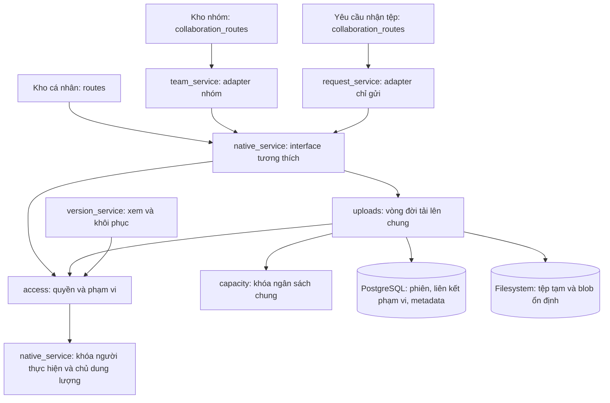

# Kho tệp — phạm vi và giao dịch tải lên

Quyết định triển khai ngày 09/11/2026; xem [ADR-0001](../adr/0001-storage-scope-and-upload-transactions.md) và [ngôn ngữ nghiệp vụ](../../GLOSSARY.md). Giữ nguyên `features/storage`, URL và schema; không thêm thư viện hoặc ứng dụng triển khai riêng.

## Interface và trách nhiệm

- `native_service.start_upload/append_chunk/finish_upload/abort_upload` giữ tên, đối số cá nhân và kết quả hiện có. Thêm đối số keyword nội bộ `team_id` hoặc `request_token`; không cho caller gửi vai trò/chủ dung lượng đáng tin cậy.
- `access.scope_guard` đọc lại người thực hiện, chủ dung lượng, gói, vai trò, thành viên và liên kết từ DB; khóa các User theo ID tăng dần rồi kiểm tra lại quyền. `scoped_node/scoped_parent` kiểm tra cả nhánh thư mục. Không dùng owner ID đơn thuần để cấp quyền kho nhóm.
- `uploads` sở hữu quota, giữ chỗ, khởi tạo phiên và liên kết, chunk, hoàn tất và hủy. `TeamUpload`/`RequestUpload`/`ReplacementUpload` cùng giao dịch với `UploadSession`. Adapter không commit một lần nữa.
- Mỗi giai đoạn tải kiểm tra lại tài khoản, gói, phạm vi và thành viên. Phiên nhóm bị từ chối qua đường cá nhân, cả khi người gọi là chủ dung lượng. Người có liên kết nhận tệp không nhận ID kho hoặc API đọc.
- Thứ tự khóa: User theo ID → phiên tải → khóa giao dịch ngân sách chung. Kiểm tra giữ chỗ diễn ra sau khóa chủ dung lượng. Không thêm `db.begin()` lồng trong Session đang có giao dịch.
- `version_service` nhận người thực hiện thật và `team_id`, tự kiểm tra quyền thay vì caller đổi sang tài khoản chủ nhóm. Khôi phục vẫn giữ bản hiện tại và bản được chọn.

`owned_node/lock_owner/archive_current` là primitive nội bộ có chủ dung lượng đã được xác lập; không dùng trực tiếp từ một endpoint mới để thay kiểm tra phạm vi. Importer chỉ đọc nguồn và bảo trì giữ interface hiện có. Bảo trì dùng `owner_lock`, không cần tài khoản đang active để giải phóng phiên hết hạn.

## Giao dịch và lỗi filesystem

Khởi tạo flush toàn bộ metadata trước khi tạo tệp tạm, rồi commit một lần. Khi thất bại, rollback metadata và chỉ dọn tệp vừa tạo nếu xác định phiên không được commit; không xóa tệp có sẵn khi tạo độc quyền bị trùng.

Chunk kiểm tra offset/kích thước, ghi và fsync trước commit. Nếu metadata chưa ghi, lần thử lại cắt phần đuôi chưa được ghi nhận. Hoàn tất dùng khóa blob bằng ID phiên: lần thử lại tìm được blob sau gián đoạn giữa rename và commit. Hoàn tất lặp trả lại mục đã tạo; hủy phiên đã hoàn tất không xóa nội dung.

Database và filesystem không cùng ACID. Nếu commit trả lỗi nhưng kết quả chưa chắc chắn, giữ nội dung có thể đã được tham chiếu. Khôi phục chỉ xóa bản sao lỗi khi chứng minh không có FileNode/FileVersion tham chiếu. Nếu DB không dùng được để chứng minh, ưu tiên giữ blob; có thể cần kiểm tra blob không được tham chiếu sau sự cố hạ tầng. Không tự quét/xóa dữ liệu người dùng trong đợt này.

## Caller đã kiểm kê

| Đường gọi | Xử lý sau thay đổi |
|---|---|
| `routes.py`: cá nhân, chi tiết/tải xuống/chia sẻ | `personal_node`, primitive có scope và vòng đời chung; bỏ kiểm tra lặp tại route |
| `collaboration_routes.py` → `team_service.py` | Giữ actor thật + team ID, không tạo phiên rồi gắn nhóm bằng commit thứ hai |
| `collaboration_routes.py` → `request_service.py` | Token-only adapter, dùng cùng vòng đời; giữ giới hạn nhận tệp và kết quả chỉ gửi |
| `version_routes.py`, `team_version_routes.py` | Gọi version interface có scope, không tự chuyển sang sponsor hoặc sở hữu transaction |
| `share_service.py`, public share routes | Giữ password/rate limit; từ chối nội dung nằm trong nhánh nhóm |
| `main.py` bảo trì | `owner_lock` + expire/commit, không chặn cleanup tài khoản đã khóa |
| `migrate.py`, `rehearse.py`, test migration | Giữ primitive owner-level nội bộ; không chạy chuyển dữ liệu lại |
| `billing/service.py`, `billing/routes.py`, `administration/routes.py` | `storage/service.py:sync_quota` tương thích giữ nguyên; thanh toán không đổi |
| Frontend personal/team/request, `app.main:app`, Dockerfile | URL, payload, entrypoint, static bundle và dependencies giữ nguyên |

Kiểm thử mặc định gồm hành vi qua HTTP và interface dùng SQLite/tệp riêng; PostgreSQL đồng thời chỉ chạy trên `cloudbox_qa`. Xem [bằng chứng](../../artifacts/qa/storage-refactor-2026-11-09.md).

## Danh mục cho đợt sau — chưa xóa hoặc gộp

| Hạng mục | Bằng chứng hiện tại và việc cần xác minh |
|---|---|
| Upload frontend | `NativeFilesPage.tsx` và `CollaborationPages.tsx` cùng điều phối start/chunk/complete/abort nhưng khác folder, progress, quyền và unmount. Cần thiết kế seam hẹp, thử hủy/đổi màn/phản hồi cũ trước khi hợp nhất. |
| Render trang chủ/tổng quan | `PortalApp.tsx` truyền LandingPage/OverviewPage vào AppShell; AppShell còn renderer mặc định PublicPage/DashboardPage. LandingPage thực sự dùng PublicPage, không phải toàn bộ là mã thừa. Cần đối chiếu entrypoint, lazy import và preview trước khi bỏ fallback. |
| Tương thích quota | `billing/service.py` vẫn import `storage/service.py:sync_quota`; đây là đường gọi đang dùng, không xóa chỉ vì Nextcloud đã ngừng. Cần tách ý nghĩa quota_synced khỏi giao dịch thanh toán ở lượt riêng. |
| Legacy/mã tham khảo | Source gateway/Mailpit/Nextcloud và CLI/build/test riêng đã được duyệt xóa ngày10/11/2026; xem [manifest](../../artifacts/qa/deadcode-cleanup-manifest.json). Template fallback và importer vẫn có consumer nên giữ. Lịch sử tài liệu được gắn nhãn riêng; không xem đó là lệnh vận hành. |

Đợt này tăng depth của module Kho: caller chỉ nêu thao tác, actor và phạm vi. Locality nằm ở quy tắc truy cập chung; leverage nằm ở một vòng đời phục vụ ba adapter. Deletion test đạt ở việc bỏ lifecycle/commit và kiểm tra phạm vi lặp trong caller, không phải đổi tên hoặc di chuyển toàn bộ cây nguồn.
